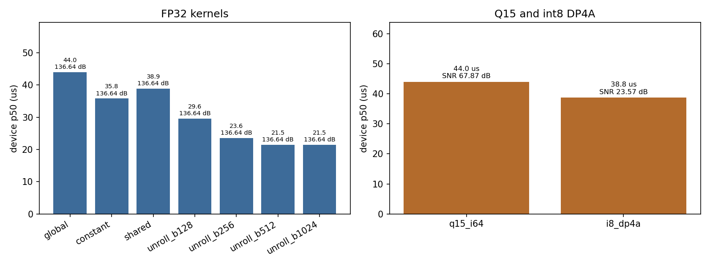
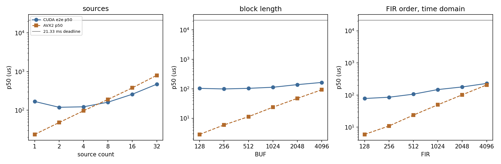
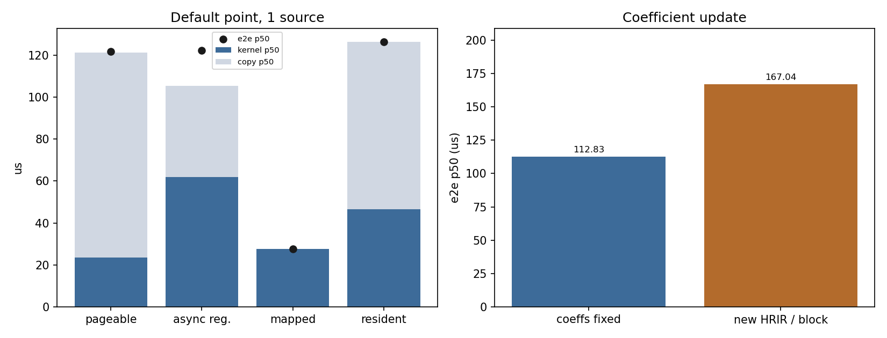

# CUDA 卸载 HRIR 卷积：实时块约束下的有效工作区间

采样率 48000 Hz。默认点是 BUF = 1024、FIR = 512、1 个声源。一块的播放时长是 1024 / 48000 = 21.33 ms，即 21333.33 us。数字来自 `results/phase1_results.md`、`results/phase2_results.md`、`results/phase3_results.md`，本报告没有重新计时。测量在 WSL2 里完成：GPU 的启动和拷贝要经 `/dev/dxg` 由 Windows 驱动转发，AVX2 不走这条通路。因此下面把“这块活太小，GPU 不划算”和“声源变多以后 GPU 更划算”当作还能讲的结论；把“慢了几微秒”和“恰好从 8 个声源起赢”标成这台 WSL 上的读数。

## 结论

- 精度与设备内选型成立。选定内核是 `f32_unroll`、块大小 512，相对双精度的 SNR 是 136.64 dB，设备内 p50 是 21.50 us。Q15 是 67.87 dB，int8 DP4A 是 23.57 dB。这些比较都在 GPU 上，或者只比误差，不吃 Windows 转发的亏。
- 一个声源的默认块，GPU 不划算，这个方向成立。历史留在显存的端到端 p50 是 112.83 us，AVX2 是 23.66 us，p99 是 590.98 us，低于 21.33 ms，欠载为 0。差距大约 90 us，大于一次转发可能加上的时间，所以“这一小块不值得卸到 GPU”在原生 Linux 上多半还在。块长 128–4096 和阶数 128–4096 的时域端到端，在这次扫描里也都慢于 AVX2。
- 声源变多以后 GPU 更划算，这个方向成立。1 到 32 个声源，AVX2 从 23.67 us 涨到 799.25 us，CUDA 端到端从 168.16 us 涨到 470.91 us。Windows 多出来的那段时间大体是每块一次，不随声源数翻倍，解释不了两条线谁涨得更快。在这台 WSL 上，p50 从 8 个声源起快过 AVX2，8、16、32 都低于播放时长。8 这个交点会被转发延迟往后推，原生 Linux 上可能更早越过，不能写成硬件规律。
- 默认点上四条通路都慢于 AVX2，其中映射零拷贝只慢大约 4 us（27.65 对 23.09）。这个名次太近，换到没有 `/dev/dxg` 的机器上可能反过来。通路之间的次序还能用：映射零拷贝比可分页同步拷贝少 93.98 us，拷贝在可分页路径里占端到端 p50 的 0.80。8 声源时，可分页整窗拷贝（166.53 us）和历史留在显存（148.96 us）都快过 AVX2（182.46 us）。cuFFT 和时域 kernel 都在 GPU 上，计算段从 FIR 1024 起 cuFFT 更快；端到端在扫过的阶数上 cuFFT 没有更快。

## 问题与有效的定义

问题是：一块音频必须在它的播放时长 `BUF / 48000` 内算完时，把 HRIR 卷积卸到 CUDA 上，从什么规模开始划算。

一条配置要同时满足两条才叫有效：端到端 p99 低于该块播放时长，并且端到端 p50 快于同一配置的 AVX2。只低于播放时长不够，因为默认点上 CPU 已经在几十微秒内算完。这个“有效”是在本机 WSL2 上比出来的。GPU 启动和拷贝多经过一次 Windows 转发，AVX2 没有，所以交点的具体声源数会偏大。

实验二固定一条搬运方式：输入历史留在显存，每块只把新的 BUF 个单声道样本送到设备，只把立体声结果取回。实验三才改搬运、不改卷积。选定的计算是共享内存里的窗口加上按 8 展开的乘加，线程块大小 512。左右耳分开算。

## 四条通路的数据流

每块输入历史是 FIR − 1 = 511 点。下面的字节数是默认点、1 个声源、本次实测的显式传输量。

可分页同步拷贝。主机用普通内存保存整窗（511 + 1024 点）。每块 `cudaMemcpy` 把整窗送上设备，kernel 读设备上的窗口，再把 1024 帧立体声拷回。显式传输 14332 字节。历史每块都往返。

```text
主机整窗 --14332 B 中的输入部分--> 设备窗口 --kernel--> 设备输出 --立体声--> 主机
```

注册后异步拷贝。字节数仍是 14332。宿主缓冲先 `cudaHostRegister`，两个 stream 让下一块的拷贝和上一块的 kernel 重叠。历史仍然每块从主机送上去。

```text
已注册的主机整窗 --异步 H2D--> 设备窗口槽 --kernel--> 设备输出 --异步 D2H--> 主机
         下一块的 H2D 与上一块的 kernel 重叠
```

映射零拷贝。`cudaHostGetDevicePointer` 让 kernel 直接读主机窗口、直接把结果写回映射内存。不调用 `cudaMemcpy`，显式字节数是 0。访问仍然走 PCIe，所以 kernel 时间里含着这些读写。

```text
已映射的主机窗口 --kernel 直接读，0 B 显式拷贝--> 已映射的主机输出
```

历史留在显存。设备上留下 511 点输入历史。每块只送 1024 个新样本，只取回立体声，显式传输 12288 字节。这是实验二的固定路径，实验三又测了一次。

```text
主机新样本 --4096 B--> 设备上的新样本
设备历史 + 新样本 --kernel，历史写回设备--> 设备输出 --8192 B--> 主机
```

## 设备内天花板

计时只包 kernel，数据预先在显存里。四档 FP32 的 SNR 都是 136.64 dB。p50 从全局内存的 44.03 us 降到展开内核的 21.50 us。块大小 512 和 1024 的 p50 都是 21.50 us，按“相差不超过 1 us 时取更小的块”，选定 `f32_unroll_b512`。



Q15 与 int8 不和 FP32 放在同一精度轴上。设备侧 `q15_i64` 的 p50 是 44.03 us，SNR 是 67.87 dB，与 CPU 的 `q15_i32`、`q15_i64` 同为 67.87 dB。这条信号的卷积输出落在大约 [-1, 1) 内，int32 累加装得下，溢出样本为 0；两档 CPU Q15 的 SNR 因此一致。int8 `__dp4a` 的 p50 是 38.75 us，SNR 是 23.57 dB，单独列出，不进入选定集合。CPU AVX2 的设备外对照是 p50 24.10 us、SNR 142.77 dB。

Nsight Compute 在本机 WSL2 上对 device 0 返回 Unknown Error，SpeedOfLight、Occupancy、LaunchStats 都没有采到硬件计数器。块大小的结论来自展开内核四行设备内耗时：p50 从 128 线程的 29.60 us 降到 512 线程的 21.50 us 后进入同一档。

## 端到端有效区间

历史留在显存。下图纵轴是对数坐标，灰线是默认块长的播放时长 21333.33 us。声源轴上的 1 声源是另一次运行，端到端 p50 为 168.16 us；默认点结论用块长轴上 BUF = 1024 的那一行，即 112.83 us 对 AVX2 的 23.66 us。



声源数 1、2、4 的端到端 p50 分别是 168.16、119.04、122.53 us，都慢于对应的 AVX2（23.67、47.98、96.59 us）。在这台 WSL 上从 8 个声源起反过来：CUDA 161.12 us，AVX2 189.98 us；16 个是 259.01 对 379.73；32 个是 470.91 对 799.25。这三档的 p99 都低于 21333.33 us，欠载为 0。交点落在 8，是含转发延迟的读数；两条线的斜率差不靠那一截固定开销，所以“再加声源，GPU 会赢”仍然成立。

块长 128、256、512、1024、2048、4096 的端到端 p50 是 103.46、98.88、103.68、112.83、138.46、164.29 us，每一档都慢于 AVX2，尽管到 BUF = 4096 时 kernel p50（93.57 us）已和 AVX2（92.57 us）挨在一起。阶数 128 到 4096 的时域端到端同样全部慢于 AVX2。FIR = 4096 时 kernel p50 171.87 us 已经快过 AVX2 的 205.76 us，端到端仍是 229.57 us，慢于 AVX2。

cuFFT 重叠相加的端到端 p50 在 FIR 128 到 4096 上是 244.32、202.43、200.42、191.26、246.78、285.25 us，都不快过同一阶的时域端到端。不含搬运的计算段从 FIR 1024 起快过时域 kernel：55.42 对 76.06、74.34 对 109.66、100.90 对 171.87（单位 us）。攒 4 块再做 FFT 时，端到端 p50 是 64659.78 us，里面含 3 块等待，相对单块播放时长 250 组全部欠载。

每块更换 HRIR 的端到端 p50 是 167.04 us，比系数固定的 112.83 us 高 54.21 us，kernel p50 仍是 45.06 us，多出来的是系数传输。stream 深度 1、2、3 的端到端 p50 是 112.83、113.86、127.65 us，加深流水线没有把 p50 降下来。这些运行的 p99 都低于播放时长，欠载为 0，但都慢于 AVX2。

## 通路分解

实验三在默认点复测四条通路，内核仍是同一条展开卷积。SNR 都是 136.64 dB。下图左柱是 kernel p50 与拷贝 p50 叠在一起，黑点是端到端 p50。注册后异步拷贝里两段相加小于端到端，因为拷贝和 kernel 有重叠，等待不在其中任何一段里。



| 通路 | 端到端 p50 (us) | kernel p50 (us) | 拷贝 p50 (us) | 拷贝/端到端 | 字节/块 | p99 (us) |
|---|---:|---:|---:|---:|---:|---:|
| 可分页同步拷贝 | 121.63 | 23.55 | 97.76 | 0.80 | 14332 | 327.36 |
| 注册后异步拷贝 | 122.18 | 61.86 | 43.62 | 0.36 | 14332 | 352.00 |
| 映射零拷贝 | 27.65 | 27.65 | 0.00 | 0.00 | 0 | 33.79 |
| 历史留在显存 | 126.40 | 46.50 | 79.71 | 0.63 | 12288 | 364.58 |

AVX2 在这次默认点测量里是 23.09 us。映射零拷贝的 27.65 us 最接近，只慢 4.56 us。四条在这台 WSL 上都慢于 AVX2，但这个 4 us 小于转发可能加上的时间，不能当成原生 Linux 上的名次。可分页拷贝占端到端的 0.80，这 97.76 us 里有一部分是 `/dev/dxg` 对小拷贝的附加延迟，不全是 PCIe 传 14332 字节的时间。注册后异步把拷贝占比降到 0.36，端到端 p50 却没有明显变短（122.18 对 121.63）。历史留在显存少搬 511 点历史（12288 对 14332 字节），端到端 p50 是 126.40 us，在这一小块上并没有短于整窗拷贝。

8 声源时两条补测都快过 AVX2：可分页 166.53 us，历史留在显存 148.96 us，AVX2 182.46 us。p99 分别是 878.34 us 和 622.69 us，欠载为 0，SNR 为 136.78 dB。在这台机器上，换成整窗拷贝没有把“声源够多时 GPU 更快”推回去。

右图只有两个点：系数固定 112.83 us，每块更换 167.04 us。结果表里没有逐方位的延迟序列，这里不把两个点连成扫描曲线。

## 环境限制

测量在 WSL2 中完成。GPU 的 kernel 启动、H2D/D2H 和映射访问经过 `/dev/dxg`，由 Windows 侧驱动转发，每一步都多一次跨界。AVX2 是虚拟机里的用户态计算，不走这条通路，所以 GPU 相对 CPU 被多加了一截时间。这一截大致按块收取，不随声源数成倍增加。它会把“慢几微秒”的名次和“从第几个声源开始赢”推偏；推不偏的是精度、GPU 路径彼此的计算段比较，以及声源增多时 GPU 耗时涨得更慢。

Nsight Compute 的硬件计数器在这块 WSL2 上不可用，设备内瓶颈用块大小扫描的耗时表示，没有 roofline。

OpenCL 未测。`clGetPlatformIDs` 返回 -1001，系统里没有厂商 ICD。实现留在 `src/opencl/fir_opencl.cpp`，没有对应的 p99。这不改变上面的 CUDA 测量；那些测量自己的限制是 `/dev/dxg`，不是 OpenCL。

播放时长只由 `BUF / 48000` 计算。耳机经 WSLg 转发的延迟不计入 21.33 ms。

## 复现

实验代码仍用下面三条命令复现，本阶段没有新的性能数字。

```bash
make
make e2e
make phase3
```

图由 `report/plot_figures.py` 读取上述三份结果表生成，不重新计时。
